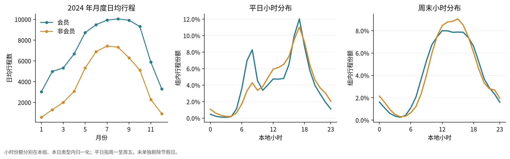
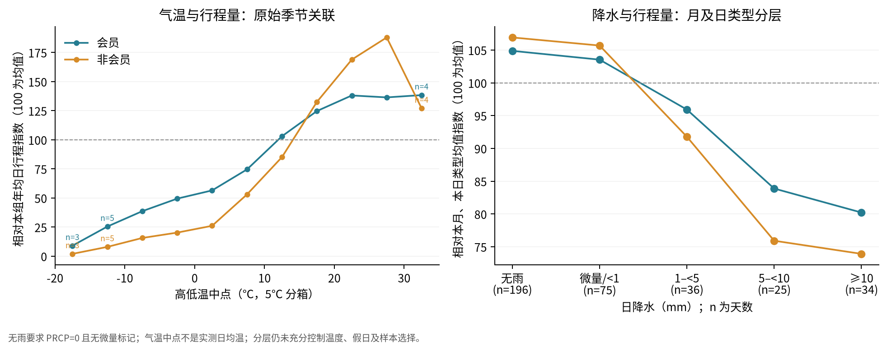

# 数据探索

## 范围与产物

主要分析为 2024 年筛选后的 **4,121,607 条行程、366 天**。会员 2,640,636 条，非会员 1,480,971 条；标签描述行程类型，不能据此计算独立用户数。天气使用 O’Hare 日观测。

2025 年保留作关系验证，只复用先前的年度覆盖与清洗计数。配置已在关联计算前保存，见 [探索范围](exploration_scope.md)。本阶段没有确认性检验或验证实验。

| 分析类别 | 内容 | 主要输出 |
| --- | --- | --- |
| 质量诊断 | 全历史既有保留率、2024 年站点缺失的车型与用户标签差异 | 图 01，`selection_quality.csv` |
| 描述统计 | 行程数、时长分布、同站返回比例、周末与平日差异 | 图 02—03，`rider_summary.csv`、`day_type.csv` |
| 时空可视化 | 月度日均量、小时份额、站点使用及坐标分布 | 图 02、04，`monthly.csv`、`hourly.csv`、`stations.csv` |
| 天气关联 | 气温、降水分箱及原始/分层指数的 Pearson、Spearman 相关 | 图 05—06，`daily.csv`、`rain.csv`、`correlations.csv` |

全部汇总表位于 `results/eda/tables/`，图表有 PNG 与 PDF，摘要和输入/代码/依赖校验值见 `results/eda/summary.json`、`run_manifest.json`。

## 1. 筛选明显改变车型构成

下列完整率的分母是“满足除站点完整性以外其他规则”的原始行计数，仅用于质量诊断，没有生成另一套缺失站点行程分析集。

| 分组 | 质控分母 | 站点完整记录 | 完整率 |
| --- | --- | --- | --- |
| 普通自行车 | 2,714,727 | 2,714,686 | 99.998% |
| 电动自行车 | 2,869,184 | 1,406,921 | 49.04% |
| 会员 | 3,585,172 | 2,640,636 | 73.65% |
| 非会员 | 1,998,739 | 1,480,971 | 74.10% |

用户标签的总体完整率接近，仍不能排除按天气、站点或车型条件产生的选择偏差。后续结论针对信息完整的筛选行程，不代表整个系统，也不能把缺失站点直接认定为数据错误。

历史保留率还受原始发布规则、车型和系统变化影响，不能据曲线判定数据质量持续恶化。

[图 01：筛选与完整率](../results/eda/figures/01_selection_quality.png)

## 2. 两组时间节律不同

| 指标 | 会员 | 非会员 |
| --- | --- | --- |
| 周末 / 平日日均行程比 | 0.77 | 1.58 |
| 平日预设早晚 6 小时的行程份额 | 50.4% | 40.7% |
| 全年行程时长中位数 | 8.92 分钟 | 13.70 分钟 |
| 时长第 95 百分位 | 32.86 分钟 | 74.30 分钟 |
| 同站点 ID 起终比例 | 2.44% | 8.66% |

非会员的周末/平日比在 **12 个月中均高于会员**，但其自身在 1、2 月仍低于 1。因此“非会员每个月周末都更多”不成立。平日未单独排除节假日，时间节律不等于个人出行目的。

全年的时长分布还混合了季节和日期构成。同日配对后，366 天中有 **349 天（95.4%）**非会员的日中位时长更长，逐日差值的中位数为 **3.31 分钟**。这是描述性比较，车型构成等因素仍需后续检查。

[图 03：时长累计分布](../results/eda/figures/03_duration_distribution.png)

## 3. 站点需求存在差异

2024 年有 1,717 个出发站点 ID，前 10 个贡献筛选行程的 **8.67%**。85 个 ID 对应不止一个站名。图中坐标来自当年行程的中位点，未用当前 GBFS 反推历史，也未据名称自动合并站点。

[图 04：站点使用与空间分布](../results/eda/figures/04_station_patterns.png)

## 4. 天气关联受季节影响

每天、每种用户标签最多一个观测，相关分析每组为 **366 天**；没有把数百万行程视为独立天气样本。使用的温度中点、降水、风速、降雪在这些日期无缺失。

分层指数定义为：当日行程数 ÷ 本组同月、同日类型（平日/周末）的日均量 ×100。该步骤同时使用各类天气日形成分母，只用于描述，不能解释为回归控制或因果调整。

| Spearman ρ | 会员原始日量 | 会员分层指数 | 非会员原始日量 | 非会员分层指数 |
| --- | --- | --- | --- | --- |
| 气温中点 | 0.82 | 0.15 | 0.87 | 0.23 |
| 降水 | -0.22 | -0.32 | -0.20 | -0.31 |
| 风速 | -0.31 | -0.13 | -0.28 | -0.17 |
| 降雪 | -0.27 | -0.02 | -0.30 | -0.05 |

气温原始相关较强，按月和日类型归一化后明显减弱，提示不能把季节关联直接当作气温效应。

无雨定义为 PRCP=0 且没有微量标记，共 196 天；雨日定义为 PRCP≥1 mm，共 95 天；其余 75 天单列。雨日/无雨日的平均分层指数比为会员 **0.831**、非会员 **0.760**，分别低约 **16.9%**、**24.0%**，差约 7.1 个百分点。但分层后的降水秩相关两组接近，不能据此宣称组间差异稳定或显著。

[图 06：相关系数对照](../results/eda/figures/06_weather_correlations.png)

气温使用 `(TMAX+TMIN)/2`，不是实测日均温。O’Hare 是单站天气代理，分层也未充分处理温度非线性、节假日、系统运营与筛选偏差；小时节律沿用来源本地时间，夏令时附近可能有歧义。

## 后续与 AI 使用

三个候选问题及用户选择见 [研究记录](research_log.md#选题记录)。问题 A 的规则经 PR #5 合并后执行，见 [验证结果](weekend_validation_results.md)。本页保留 2024 年发现阶段结果。

程序、图表、上述模式归纳及候选问题由 AI 辅助生成；用户在对话中确认了清洗规则和年度划分。本阶段尚未记录用户独立发现的统计规律，不将 AI 计算结果记为用户独立发现。

来源：[Divvy 官方数据](https://divvybikes.com/system-data)、[NOAA GHCN-Daily](https://www.ncei.noaa.gov/pub/data/ghcn/daily/)，使用 2026-11-09 下载快照；具体文件版本见下载、整理和本次运行清单。
