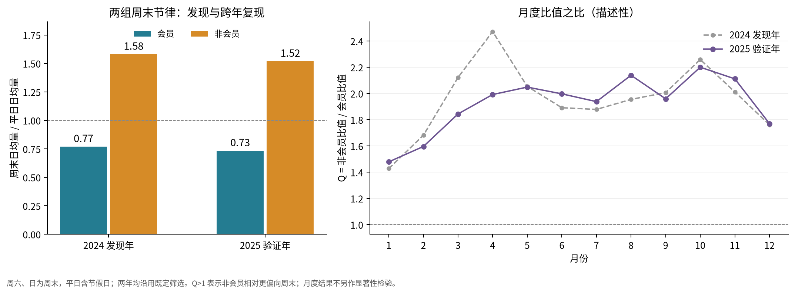
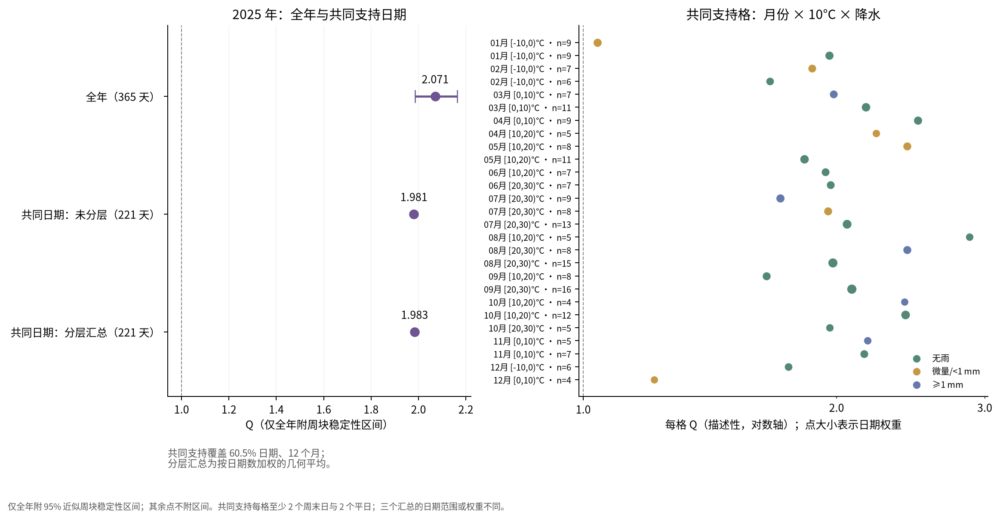

# 周末节律差异：2025 年验证结果

在既定筛选口径与预设周块重抽样假设下，2025 年结果对“非会员的周末/平日日均行程比高于会员”提供**初步支持**。月份与天气分层后，共同支持日期内的方向一致。

## 1. 范围与执行规则

2024 年用于发现，用户据此选择问题 A；[验证方案](weekend_study_protocol.md) 已通过 [PR #5](https://github.com/AlphaSpire8/vibe_coding_homework/pull/5) 合并，再开始本次 2025 年关系分析。程序核对冻结配置的 SHA-256，未调整分箱、支持门槛或主判据。

2025 年原始表有 5,552,964 条记录，既定过滤后有 **3,661,513 条**：会员 2,351,456 条，非会员 1,310,057 条，无其他用户标签。来源记录覆盖 365 天，其中平日 261 天、周末 104 天。全年原始及筛选计数与整理清单一致；所需气温、降水无缺失。沿用本地出发日期，周六、日为周末，平日包含节假日。

## 2. 全年主验证

```text
R[g] = 本组周末日均行程数 / 本组平日日均行程数
Q    = R[casual] / R[member]，预期 Q>1
```

| 用户标签 | 平日日均行程数 | 周末日均行程数 | 周末/平日比 R |
| --- | --- | --- | --- |
| 会员 | 6,971.98 | 5,113.16 | 0.733 |
| 非会员 | 3,127.11 | 4,748.86 | 1.519 |

**Q=2.071**：非会员的周末/平日比约为会员的 2.07 倍。按月份分层、两组配对抽取自然周块，保留年首尾不完整周；53 个周块重抽样 10,000 次，随机种子 20261109，全部有效。第 2.5%—97.5% 分位形成的近似稳定性区间为 **[1.985, 2.164]**，下界大于 1，满足预设主判据。

12 个月的 Q 均大于 1，范围为 1.479—2.200；这是月度描述，不另作显著性判断。非会员自身 1、2 月的 R 仍低于 1，研究假设比较的是两组 R 的相对大小。



2024 年发现值 Q 约为 2.053，本次验证方向一致；不将发现年重新作为确认性证据。

## 3. 额外实验：月份与天气分层

按月份×10°C 气温区间×三类降水状态分层。气温为高低温中点，区间左闭右开、原点为 0°C；降水分为无雨、微量/不足 1 mm、至少 1 mm。每格至少 2 个周末日、2 个平日，仅按日期和天气决定支持范围。

80 个非空格中，**27 格**满足共同支持，覆盖 **221/365 天（60.5%）**，包含 148 个平日、73 个周末日，涉及全部 12 个月。另 144 天因同格日类型支持不足排除；没有因天气缺失排除的日期。主分析仍使用全年 365 天。

| 比较 | 日期数 | Q | 不确定性处理 |
| --- | --- | --- | --- |
| 全年未分层 | 365 | 2.071 | 预设周块稳定性区间 [1.985, 2.164] |
| 共同支持日期，未分层 | 221 | 1.981 | 描述性点估计 |
| 同批日期，分层汇总 | 221 | 1.983 | 日期数加权的格内 Q 几何平均，描述性 |

27 个支持格的 Q 均大于 1，两组×两种日类型的四个总量均为正，未触发不可估规则。分层汇总保持预期方向，提供共同支持范围内的方向性稳健性证据；不把逐格同向解释为逐格显著。



从 2.071 到 1.981 改变了日期范围；从 1.981 到 1.983 改用了格内 Q 的日期加权几何汇总，统计目标也随之改变。不能用这些差值计算“天气解释了多少差异”，也不能将 221 天内的分层结果直接推广至其余日期。

## 4. 结论边界与 AI 使用

主验证获得初步支持，额外实验在共同支持日期内方向一致。结论限于站点信息完整、时长 60 秒至 24 小时且通过既定规则的行程；站点筛选对车型构成的影响见 [探索报告](exploratory_analysis.md)。member/casual 是行程标签，不能据此识别个体、通勤或旅游目的。

稳定性区间依赖同月周块近似可交换的假设；跨月周和年首尾部分周按方案处理，仍不能消除更长时间相关性。天气仅用机场单站代理，10°C 分箱仍有格内差异，节假日、车型、站点及运营变化也可能影响结果。该研究检验观察到的关联，不作因果解释。

问题候选、计算、代码、图表与结果归纳由 AI 辅助完成；研究问题、清洗口径、发现/验证年份及天气分层粒度由用户选择，具体验证方案经用户合并 PR #5 确认。本次未把 AI 得到的统计结果记作用户独立发现。

## 5. 复现与产物

根目录执行 `uv run python -m scripts.validate_weekend`。结果位于 `results/validation/`：两张核心图均有 PNG/PDF，8 份 CSV 包含逐日计数、年度及月度比值、全部非空天气格、月度覆盖、周块、10,000 次重抽样及三种汇总比较；`summary.json` 保存数值与判定，`run_manifest.json` 记录配置、输入、代码、依赖和输出校验值。程序完成全部计算后替换结果目录，失败时保留原有结果。

验证包括原有及新增共 27 项测试；覆盖配对周块、月份块数、缺失日与零计数、年份边界、日期加权以及零总量支持格的保留。两张图已检查中文显示与布局。
